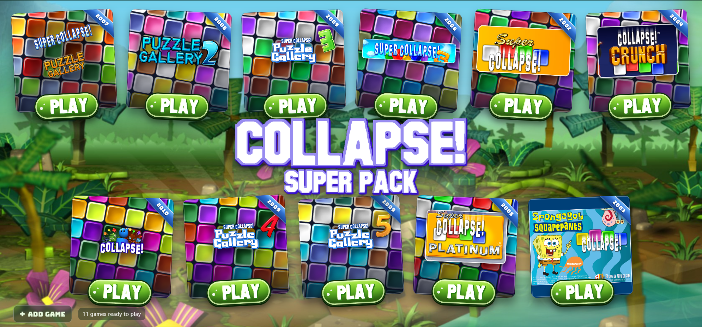

# Collapse! Super Pack — launcher

A small desktop launcher for this Super Collapse! collection. One window, one
cover per game, one PLAY button — and room for any further Collapse game you
add later.



## Running it

Double-click **Collapse Super Pack.exe** in the collection folder (the folder
holding `SuperCollapse3`, `collapse!`, `Collapse! Crunch` and the rest). It needs
nothing installed — the exe carries Electron, the art and BitBit with it — and it
finds the games by looking in the folder it was started from, so the launcher and
the games stay together. On each start it refreshes the paths for the known games
from that folder. A path chosen with **Locate** is kept as a manual override.
Libraries from older launcher versions did not record whether a path was
automatic or chosen with Locate, so an existing path in one of those libraries is
also kept and treated as manual. Before that migration the previous file is saved
as `library.json.bak`; if a backup already exists, the previous file is saved
with a timestamp instead. The first launch takes a few seconds while the exe
unpacks itself; after that it is quick.

It is not signed with a code-signing certificate, so Windows may show a
SmartScreen "unrecognised app" prompt the first time: **More info → Run anyway**.

Building it from source:

```
npm install      # once, downloads Electron and electron-builder
npm run dist     # writes dist/Collapse Super Pack.exe
```

The icon comes from `build/icon.ico`. Copy the finished exe into the collection
folder, next to the games.

While working on the launcher itself, `npm start` runs it straight from source
(or double-click **Launch Collapse Pack.bat**).

That build keeps its `library.json` and `settings.json` in
`%APPDATA%\Collapse Super Pack\` instead of `data/`, because the exe may sit
somewhere read-only; the first run copies the shipped `data/library.json` there,
so the per-game display settings survive. Delete those files to go back to the
default eleven games.

## How it works

- The eleven games that ship in this folder are listed in `data/library.json`.
  The file is created on first run and rewritten whenever you change the list.
- **PLAY** starts the game detached, with the game's own folder as the working
  directory — these old titles load their assets relative to it.
- **LOCATE** (orange button) appears when a game's file is missing. Click it and
  pick the executable; the launcher remembers the new path.
- **+ Add game** at the bottom left adds anything else — Collapse Crunch,
  SpongeBob Collapse, a re-installed copy — with a browse dialog.
- Right-click a cover for Play / Locate / Show in folder / Rename / Game
  settings / Remove. Removing a game only drops it from the launcher; the files
  are untouched.

If a game is moved or re-installed somewhere else, its cover shows an orange
**LOCATE** button — click it and pick the executable again.

## Settings

There are two gears, and they save different things.

**Bottom-right of the window** opens the launcher settings, stored in
`data/settings.json`:

- **Box size** — small, medium or large covers; the grid re-fits itself.
- **Release years** — show or hide the year sash on each box.
- **Animations** — the pop-in when the launcher opens and the lift on hover.
- **Ask before removing** — confirm before a game is taken out of the launcher.
- **GitHub updates** — **Check for updates** reads the latest release from
  `thegamer14/collapse-super-pack-launcher`. The portable launcher downloads the
  new exe, replaces itself after closing, keeps the previous exe as
  `Collapse Super Pack.exe.old`, and reopens. **Release page** opens the GitHub
  releases in the browser. The launcher version is shown beside the button.

**Next to each PLAY button** opens that game's own settings:

- **Launch arguments** — passed to the executable, e.g. `-windowed`; quoted
  values such as `"two words"` arrive as one argument.
- **Working folder** — start the game from somewhere other than its own folder.
  Leave it empty for the default.
- **Display** — **Scaled** runs the game through BitBit (below) at a
  resolution you pick; **Borderless** fills the screen without BitBit for the
  2010 engine; **Window** leaves it in its own little window. Fixed-size games
  default to Scaled, and Collapse! (2010) defaults to Scaled with Fill so it
  leaves its old 1024×768 window and the black side bars behind.
- **Resolution** — the size the game is presented at: the whole screen, or
  1920×1080, 1600×900, 1366×768, 1280×720, 1024×768.
- **Shape** — **Fit 4:3** keeps the game's shape with black bars at the sides;
  **Fill 16:9** stretches it to the whole screen for widescreen.
- **Scaling quality** — **Smooth** uses BitBit's HALFTONE filter; **Sharp
  (fast)** uses nearest-neighbour, which is lighter on slower GPUs.
- **Run as administrator** — starts the game through a UAC prompt, which some of
  these titles need before they can write a save file.
- **Launch log** — **Launcher settings → Launch diagnostics** opens
  `launcher.log`. It records startup information, game paths, launch commands,
  helper output, process IDs and exit codes, and whether the game process was
  still running six seconds after launch. Use **Copy log** to send the details
  when a game will not start.

### Codes

When a game has verified promo codes, a **CODES** button appears beside its
PLAY button (on the box, separate from the settings gear). The list is in
`src/game-codes.js`.

Collapse! (2010) has two codes found directly in `collapse.exe`, next to the
Redeem Codes UI strings:

- **`eindhoven`** — Clown outfit
- **`paris`** — Pirate outfit

The launcher searched the installed collection and found no other promo-code
entries. `paris` is the code for the Pirate outfit, not an outfit name. Other
Pirate and Clown matches occur elsewhere as puzzle themes, puzzle artwork, and
avatar names, but those are not redeem codes. The codes button only appears for
games with a verified code entry; the launcher shows and copies the codes but
does not apply them to a save.

### Progress, cloud and Discord

The game gear also has **Unlock all progress**, **Back up save** and
**Restore save**. Unlock-all always writes a timestamped backup first. For Super
Collapse! 3 it patches the seven Game Parlor lock checks in the game executable
(`SuperCollapseIII.exe.launcher-original` is kept beside it), so the Quick Play
modes appear without changing the player's save data.
Collapse! (2009/2010) keeps its profile in an encrypted `players.plrs` file;
the launcher will not rewrite that file. It backs it up and points you at the
game's own **DEBUG** button on the main menu instead.

Cloud saves and the shared leaderboard use the small worker in `cloud/`. The
default URL is the hosted Collapse Cloud endpoint; change it in **Launcher
settings → Cloud saves & leaderboards**. Saves are protected by a per-PC key
generated in the launcher data folder, and score names are shown on the shared
board. Because the original games' saves are encrypted, leaderboard scores are
submitted from the **Leaderboard** sheet rather than scraped out of the save
file.

Discord Rich Presence is on by default and uses the launcher's own Discord
application (`1570871731571134615`). Turn it off with **Show what I am playing**
in **Launcher settings**. The application field is only there if you want to use
a different Discord application; a bot token is never needed, and the launcher
simply stays disconnected when Discord is not running.

Rich Presence only needs the Discord **Application ID**. The application's
**Public Key** is the `verify_key` for Discord Embedded App/Activity requests
and is not used by local Rich Presence.

While the launcher is open it follows any of the collection's games, including
ones started from Explorer, and shows the matching cover art on the Discord
activity card. If the activity does not appear on your Discord profile, check
**User Settings → Activity Sharing** and make sure **Share my activity** is on
and your status is not set to **Invisible**.

Those live on the game in `data/library.json` under `settings`, so they follow
the tile through renames and relocations.

## Display: BitBit

Collapse! (2010) also has an engine-level `widescreencontent` flag in
`properties/application.xml`. The shipping value is `false`, which makes the
game draw its 4:3 canvas letterboxed inside a 16:9 window. The launcher sets the
flag to `true` at launch (keeping the original as
`application.xml.launcher-original`) and exposes a **Widescreen content fix**
toggle in the game's gear. This is the fix for side bars that survive even when
the game is already fullscreen.

Every game here except Collapse! (2010) paints a fixed 640×480 or 800×600
surface and ignores its window size, so no setting inside the game can make it
bigger. **BitBit** (`tools/bitbit/BitBit.exe`) is the upscaler that fixes that: a
purpose-built dgVoodoo for these titles, except that they never touch Direct3D
or DirectDraw at all — they are plain GDI, so a ddraw proxy would never load.
It captures the game's window and re-presents it, scaled, in a borderless
always-on-top overlay:

- **the picture runs at the monitor's refresh rate.** Presentation is clocked by
  `DwmFlush`, which returns on each composed frame, so there is no fixed timer.
  The HALFTONE stretch costs about 10 ms at 1080p, so it is done only when the
  game's frame actually changed (the 800×600 frame is read back and compared,
  ~1 ms) and cached; every refresh then copies that cached picture 1:1. Measured
  on a 144 Hz panel: ~126 fps at 1920×1080 with HALFTONE quality, ~2.6 ms a
  frame. Add `--nearest` for COLORONCOLOR scaling if you prefer speed over
  smoothing;
- **the pointer is the real one.** Instead of hiding the cursor and drawing a
  copy (which is how you end up with two cursors and a pointer that drifts), the
  game's window slides underneath the cursor so the game pixel under the pointer
  is the pixel being pointed at. The slide happens in the mouse hook, on the
  event itself, so a fast flick cannot outrun the window. The system then draws
  the game's own cursor at the right place, and clicks arrive as ordinary mouse
  messages through the click-through overlay;
- **Ctrl+Alt+F12** leaves scaled mode: the overlay closes and the game is left
  running in its own window. Quitting the game closes the overlay.

Each cover carries a chip showing how it will be presented — `1920 × 1080` for a
BitBit game, `SCREEN` when it follows the monitor, `WINDOW` when it is not
upscaled — so the display settings are visible without opening the gear.

Rebuild it with `tools/bitbit/build.cmd`, which uses the C# compiler that ships
with Windows — no SDK, no packages. The log is off by default; set `BITBIT_LOG`
to a file path to get frame timings.

## Trial wrappers

Two of these titles were sold inside time-limited launchers, and on Windows 11
those launchers are the broken part — not the games.

**Collapse! Crunch.** `collapse3_r1a.exe` is a RealArcade trial wrapper: it
unpacks the real game to `Collapse3.exe` beside itself, runs it, then deletes it
again, and it needs administrator rights to write its licence key. On this
Windows it unpacks but never shows its own window, so the launcher runs the game
directly instead. That copy lives in `Collapse! Crunch/unpacked/` (with
`collapse3.bin`, which the game reads for its art and sound). To re-create it
after a fresh install of Crunch, run the wrapper once, then copy `Collapse3.exe`
and `collapse3.bin` into `unpacked/`.

**Super Collapse!** There are two copies in this collection, and only one of
them can run.

The one the launcher uses is `Super Collapse!/Collapse.exe` — the 2002 GameHouse
build. It is an ordinary executable (a real `.text` section, ordinary imports),
it opens at a true 800×600, and it plays on Windows 11 as-is, so its tile shows
**PLAY** and BitBit presents it like the rest of the collection.

`Super Collapse/Collapse.exe` (the 2003 Reflexive Arcade copy) is the packed
one: an ASProtect 1.23 RC1 stub with the real game encrypted inside. The stub
decodes itself into a buffer and jumps there, and on current Windows the decode
never happens, so the process dies in about 20 ms with an access violation
before a single window or a single API call. Compatibility layers (Windows
95/98/XP, 16-bit colour, 640×480), administrator rights and DEP opt-out make no
difference, and its `Collapse.dll` holds only the game's resources, not its
code. The launcher recognises that build and refuses to start it with an
explanation instead of failing silently — point that tile at a working copy with
**LOCATE** if you would rather it used a different build.

A Rust/WebAssembly rebuild of the same game — original art and sound, running in
any browser — lives in [`../SuperCollapseRS`](../SuperCollapseRS).

The tracer work behind that verdict — where the loader stops, the Windows XP
constant it depends on, and why no amount of patching yields game code — is
written up in [docs/super-collapse-2003.md](docs/super-collapse-2003.md).

## Artwork

`assets/` is generated. The covers, the year ribbons and the jungle background
are composited from the games' own sprites and title art: the block tiles come
from `collapse!/images/scenegamebase`, the jungle from
`collapse!/images/sceneselection`, and the logos were extracted from each
game's packed archive. Those extracted source images live in `assets/source/`.

The **COLLAPSE! SUPER PACK** title and the PLAY / LOCATE button labels are
lettered from the game's own chamfered typeface: `tools/lettering.py` lifts the
glyphs out of `collapse!/fonts/header_quickplay01_base.png`, cleans up their
edges and rebuilds the white-face / purple-bevel / navy-outline treatment, so
the launcher is written in the same alphabet as the menus it launches.

To rebuild after changing the recipes:

```
python tools/build_assets.py     # needs Pillow; reads ../collapse! and assets/source
```

## Layout

The window sizes itself to the collection: the games split into a top and a
bottom row around the middle logo, and the row grows a column at a time (8 games
= 4+4, 11 games = 6+5, and a short last row stays centred). If the window or the
screen is smaller than the layout, everything scales down proportionally.

## Development

```
npm run smoke                    # loads the window and quits
npx electron . --capture out.png # renders the window to a PNG
node tools/test-launch.js        # checks launching, arguments and working folder
```

`data/library.json` is your list — delete it to get the default eleven back.
`data/settings.json` holds the launcher preferences and is created the first
time one is changed.

## Licensing

The launcher code is yours to use. The artwork and the bundled font
(Titan One, SIL Open Font License, see `assets/fonts/OFL.txt`) are included for
personal use with the games you own; the game art remains the property of its
respective rights holders.
